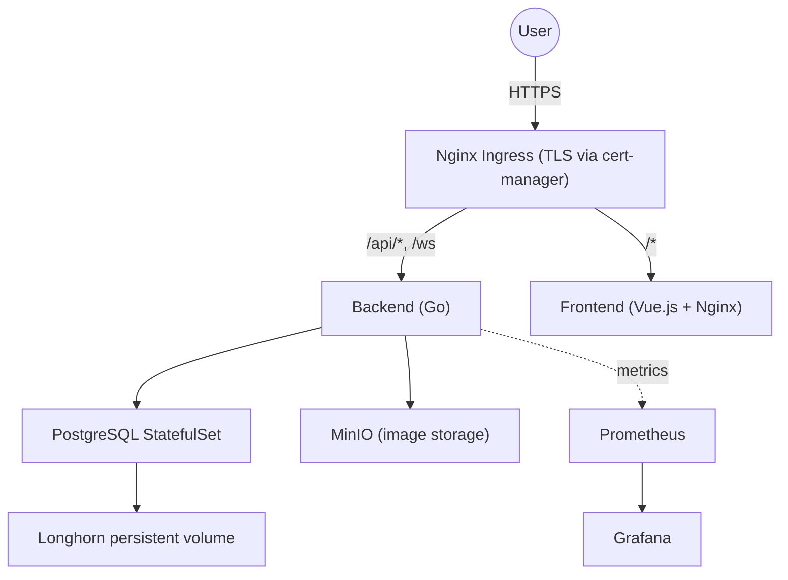

# Mezdit – Reddit-Style Social Platform

A Reddit-style social platform with a Go REST API, a Vue.js front end and real-time updates over WebSocket, deployed to Kubernetes with Helm through an automated GitLab CI/CD pipeline. Built for the DevOps & Software Delivery Automation course at the University of Tartu.

## Features

- **Accounts:** registration, login and password change, with JWT authentication and bcrypt password hashing
- **Posts:** create, edit and view posts with optional images, public or private visibility, and anonymous posting
- **Voting:** upvote and downvote with toggle logic, stored with database transactions
- **Real-time updates:** new posts, edits, votes and privacy changes are broadcast to all connected clients over WebSocket
- **Security:** input sanitization against XSS, input size limits, parameterized SQL queries and secret detection in CI

## Architecture



## Tech Stack

| Area | Technologies |
|---|---|
| Back end | Go 1.23, PostgreSQL, MinIO, WebSocket, JWT |
| Front end | Vue.js 3, Vuetify 3, Nginx |
| Containers | Multi-stage Docker builds, Kaniko |
| Orchestration | Kubernetes, Helm 3, Longhorn, cert-manager |
| CI/CD | GitLab CI/CD, GitLab Container Registry |
| Security | Trivy image scanning, Gitleaks secret detection |
| Observability | Prometheus, Grafana |

## CI/CD Pipeline

```
Code push → Security scan → Test → Build image → Deploy to staging → (manual) Deploy to production
```

- **Build:** images are built inside the cluster with Kaniko and tagged with both `latest` and the commit SHA, so any version can be rolled back.
- **Security:** Trivy scans every image for critical and high vulnerabilities, and Gitleaks checks the code for leaked secrets.
- **Deploy:** staging deploys automatically from `main`; production is a manual step with its own Helm values.

## Production Setup

- **Autoscaling:** a Horizontal Pod Autoscaler runs the back end on 2–5 replicas based on CPU usage.
- **High availability:** pod anti-affinity spreads back-end pods across nodes, and rolling updates replace pods only after the new ones pass their readiness checks.
- **Health probes:** `/healthz` (liveness) restarts a stuck process, and `/readyz` (readiness) takes a pod out of traffic when the database is unreachable.
- **Monitoring:** the back end exposes Prometheus metrics, and Grafana dashboards track latency, traffic, errors and saturation, along with resource usage, pod restarts and autoscaling.
- **Stateless design:** JWT authentication, MinIO for files and PostgreSQL for data, so pods can be restarted or scaled without losing state.

## Repository Structure

```
devops-be/     Go back end, Helm chart and Kubernetes manifests
devops-fe/     Vue.js front end, Helm chart and Nginx configuration
devops-demo/   Full project documentation
```

## Documentation

- [Back end: API, authentication, local setup and testing](devops-be/README.md)
- [Front end: features, configuration and local setup](devops-fe/README.md)
- [Kubernetes setup](devops-be/KUBERNETES_SETUP.md)
- [Full project documentation: architecture, Helm, CI/CD, monitoring and autoscaling](devops-demo/PROJECT_DOCUMENTATION.md)
